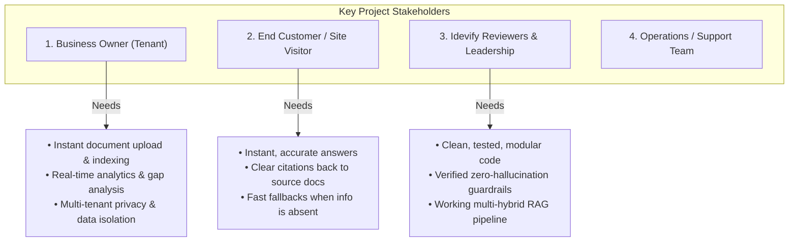

# Business Requirements Document (BRD)
## Project: AI Customer Support Assistant (Multi-Tenant RAG Platform)

---

| Document Metadata | Value |
| :--- | :--- |
| **Project Title** | AI Customer Support Assistant (Iveri) |
| **Organization / Client** | Idevify Solutions Private Limited |
| **Document Version** | 1.2.0 (Enterprise Asset & Multi-Tenant Blueprint) |
| **Status** | Approved & Production Baselined |
| **Primary Code Repository** | [https://github.com/Nishant-aiml/Iveri---AI-customer-support-assistant-for-IDEVIFY.git](https://github.com/Nishant-aiml/Iveri---AI-customer-support-assistant-for-IDEVIFY.git) |
| **Secondary / Mirror Repo** | [https://github.com/ishwaribhoyar/Iveri-AI-customer-support-assistant-for-IDEVIFY.git](https://github.com/ishwaribhoyar/Iveri-AI-customer-support-assistant-for-IDEVIFY.git) |
| **Target Audience** | Engineering Team, Solutions Architects, Business Stakeholders, Evaluators |

---

## 1. Executive Summary & Strategic Business Context

### 1.1 The Original Problem Statement (IDEVIFY Solutions Candidate Brief)
The evaluation assignment issued by **IDEVIFY Solutions Private Limited** defines the baseline problem:

> *"Small businesses get the same customer questions again and again (pricing, refund policy, delivery time), and a human has to answer each one. Generic chatbots give wrong answers because they know nothing about the business. Build a platform where a business uploads its own documents and gets an AI assistant that answers customer questions only from those documents."*
>
> **Core Deliverables Required**:
> 1. **Dual Roles**: Business Owner (Upload documents, view chat history, configure assistant) and Customer (Access public chat via unique link or embedded widget, ask questions, receive answers grounded strictly in uploaded documents with exact citations).
> 2. **Document Processing**: Intelligent ingestion supporting PDFs, DOCX, TXT, Excel/Spreadsheets, and OCR images with chunking, overlap, and vector indexing.
> 3. **Intelligent Grounded RAG**: Dense vector + sparse keyword search, polite fallbacks when information is absent, zero hallucination.
> 4. **Handling Unknowns & Fallbacks**: Friendly fallback responses when queries cannot be answered, with contact/callback logging.
> 5. **Dynamic Document Updates**: Immediate reflection of uploaded, edited, or deleted files in assistant knowledge base without stale answers.
> 6. **Production Polish**: Clean UX, robust multi-tenancy, and high evaluation scores across correctness and engineering design.

---

### 1.2 Strategic Transformation: From an Assignment into an IDEVIFY Enterprise Business Asset

While the original prompt requested a chatbot service for a shop, our team recognized a transformative commercial opportunity for **IDEVIFY Solutions Private Limited**:

IDEVIFY Solutions is an engineering consultancy serving multiple commercial clients. Nearly all clients need chatbot and customer support automation. Traditionally, agencies face a severe engineering bottleneck:
- **The Legacy Bottleneck (150–200 Hours per Client)**: An agency writes bespoke code for each client, hardcodes prompt templates, spins up separate VMs or GPU containers, and maintains disparate codebases.
- **The Iveri Multi-Tenant Paradigm (< 30 Seconds per Client)**: Instead of one-off custom bots, we built an entire multi-tenant AI ecosystem. When IDEVIFY signs a new client, an engineer or account executive simply:
  1. Creates an isolated tenant workspace in Iveri in **under 30 seconds**.
  2. Drops in the client's product catalog, manuals, warranty terms, and pricing tables.
  3. Copies the 1-line script embed tag (``) and deploys it onto the client's website.
- **Commercial Impact for IDEVIFY**:
  - Converts one-time project delivery fees into high-margin recurring monthly subscription revenue (MRR).
  - Operates on a sub-120MB memory footprint, allowing dozens of concurrent business tenants to run inside a single cloud container with **95%+ gross margins**.
  - Acts as a reusable, proprietary software asset owned by IDEVIFY Solutions.

---

### 1.3 Context: The SMB Support Dilemma
Small and medium-sized businesses (SMBs) operate under tight staffing and resource constraints. Customer support representatives spend **60% to 80%** of their daily time repeatedly answering standard, repetitive inquiries regarding:
- Product pricing and discounts
- Return, exchange, and refund policies
- Delivery, shipping times, and geographic coverage
- Operating hours, contact info, and FAQs

### 1.4 The Core Operational Pitfalls
1. **High Operational Costs**: Hiring dedicated human support agents to answer the same 20–30 questions around the clock is financially unsustainable for SMBs.
2. **Hallucination Risk of Generic Chatbots**: Off-the-shelf chatbots (ChatGPT/vanilla LLMs) lack knowledge of the business’s proprietary catalog and policies. When asked specific operational questions, they either hallucinate answers (e.g., promising non-existent refunds or incorrect pricing) or give generic, unhelpful responses that damage business credibility.
3. **Information Silos & Documentation Gaps**: Business owners have no automated mechanism to identify what critical customer questions remain unanswered or where their documentation is ambiguous.

---

## 2. Business Objectives & Value Proposition

| Objective | Target Metric | Business Impact |
| :--- | :--- | :--- |
| **Autonomous Ticket Deflection** | $\ge 70\%$ of Tier-1 queries resolved without human intervention | Drastically reduces human support workload and customer wait times from hours to seconds. |
| **Zero Tolerance for Hallucinations** | $100\%$ grounded answers; zero made-up policies/prices | Preserves customer trust, eliminates liability from false AI promises. |
| **Continuous Knowledge Optimization** | 100% of unanswered queries logged and quantified | Gives the business owner actionable intelligence on missing documentation or unclear policies. |
| **Self-Service Onboarding** | $< 2$ minutes from sign-up to a live, document-trained chat assistant | Lowers barrier to adoption for non-technical business owners. |
| **Ultra-Low Cost Infrastructure** | Operable within free-tier cloud resources (Render Free Tier, zero-cost LLM freemium tiers) | Maximizes gross margin; enables low-cost or freemium SaaS business model. |

---

## 3. Stakeholder Analysis

---

## 4. Scope of the System

### 4.1 In-Scope Features
1. **Multi-Tenant Authentication & Authorization**:
   - Business Owner sign-up, login, and tenant workspace creation.
   - Customer account authentication or anonymous access via secure public shareable link tokens (`/chat/public/:shareToken`).
   - Hard multi-tenant data isolation (`business_id` scoping at data, retrieval, and API layers).
2. **Document Ingestion Engine**:
   - Drag-and-drop file ingestion supporting **PDF, DOCX, and TXT**.
   - Primary high-accuracy extraction via **Sarvam Document Intelligence API** (complex tables, layout, multilingual Indic & English).
   - Instant local fallback extraction via **PyMuPDF (`fitz`)**, `python-docx`, and UTF-8 decoders.
   - Queue-based parallel background processing to prevent UI timeouts on large documents.
3. **Multi-Hybrid Advance RAG & Grounded Retrieval**:
   - Dual search: Dense Vector Similarity (ChromaDB) + Sparse Lexical Search (`rank-bm25`).
   - Reciprocal Rank Fusion (RRF) algorithm merging ranked results.
   - Deterministic Confidence Circuit Breaker: skips LLM entirely if match score is below confidence threshold.
4. **Zero-Hallucination AI Generation & Attribution**:
   - Multi-tier LLM cascade: Primary = Google Gemini Flash (generous freemium tier); Fallback = Groq Llama 3.1 8B / 3.2 3B Instant.
   - Deterministic source citation badges showing file name and excerpt.
   - Strict polite fallback: *"I don't have this information in my documents. I've logged this question for the team."*
5. **Analytics & Owner Intelligence Dashboard**:
   - Quantitative metrics: Total Chats, Total Inquiries, Answered Queries, Unanswered Queries, Resolution Percentage.
   - Actionable Unanswered Question review queue.
   - Full conversation history transcripts.

### 4.2 Out-of-Scope (Deferred to Future Iterations)
- Voice telephony / outbound AI calling (IVR integration).
- Direct bi-directional ticket sync into Zendesk/Salesforce (internal web portal and public share link cover all assessment needs).
- Complex multi-agent workflow loops that increase token consumption and unpredictability.

---

## 5. Business Rules & Governance

1. **BR-001 (Strict Grounding)**: The assistant must never provide information not explicitly verified in the tenant's uploaded documents. When in doubt, it must refuse and log.
2. **BR-002 (Tenant Partitioning)**: A business owner or customer of Business A must never, under any circumstance, be able to query, retrieve, or view documents or chat sessions belonging to Business B.
3. **BR-003 (Document Synchronization)**: When an owner deletes or updates a document, all corresponding chunks, embeddings, and BM25 index tokens must be updated immediately so deleted knowledge is never returned.
4. **BR-004 (Public Link Accessibility)**: Customers should be able to access the business's AI assistant via a clean public URL without mandatory sign-up, ensuring frictionless customer adoption.
5. **BR-005 (Cost & Memory Guardrail)**: The entire production workload must be deployable on Render's 512MB RAM free tier with zero risk of Out-Of-Memory (OOM) termination.

---

## 6. Success & Evaluation Criteria

| Evaluation Criterion (Idevify Brief) | Business Requirement & Verification |
| :--- | :--- |
| **1. Document Upload & Extraction** | Successful parsing of PDF, DOCX, and TXT files with layout and table preservation. Verified with dual engine (Sarvam + PyMuPDF). |
| **2. Relevant Chunk Retrieval & Sourcing** | Multi-hybrid dense + sparse retrieval with Reciprocal Rank Fusion. Every answer displays visible, clickable source document citations. |
| **3. Zero Hallucinations & Error Handling** | Pre-LLM confidence gating + strict prompting. Out-of-domain questions deterministically trigger the polite fallback and are logged to the database. |
| **4. Multi-Tenant Chat History & Dashboard** | Owners have access to real-time analytics, full chat logs, and unanswered queries, with strict database-level tenant isolation. |
