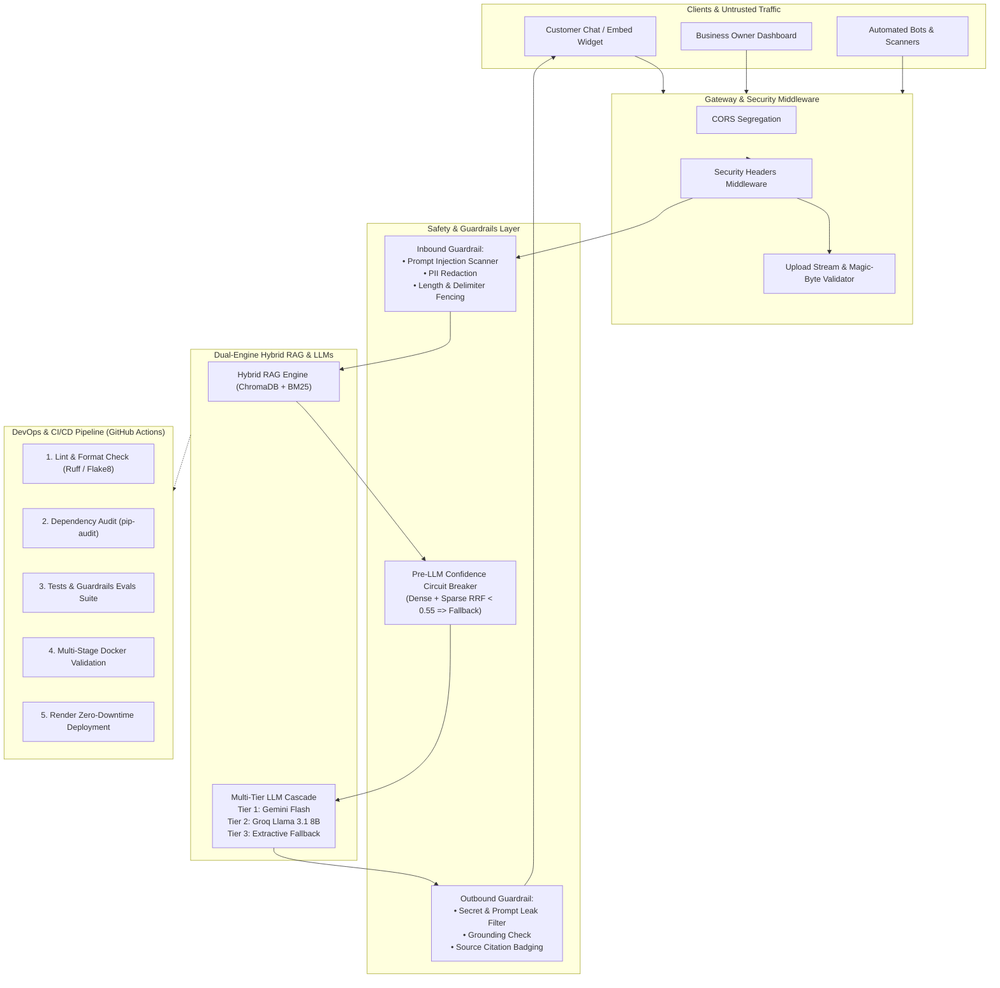

# IDEVIFY: Cybersecurity, Guardrails, Evals & DevOps / CI/CD Architecture

This document outlines the security architecture, real-time safety guardrails, continuous evaluation (evals) framework, and automated CI/CD pipelines for **IDEVIFY** (Iveri AI Customer Support Assistant).

---

## 1. System Architecture & Threat Boundaries



---

## 2. Cybersecurity & Application Hardening Controls

### 2.1 HTTP Security Headers
Every HTTP response from the FastAPI application includes defensive headers:
- `X-Content-Type-Options: nosniff`: Prevents MIME-type confusion attacks.
- `X-Frame-Options: SAMEORIGIN`: Protects the Owner Dashboard against clickjacking while allowing the embeddable chat widget script to be placed on customer websites.
- `Referrer-Policy: strict-origin-when-cross-origin`: Restricts referrer URL leakage.
- `Permissions-Policy: camera=(), microphone=(), geolocation=()`: Disables high-privilege browser hardware APIs.
- `Strict-Transport-Security: max-age=31536000; includeSubDomains`: Enforces HTTPS in production environments.

### 2.2 Sliding-Window Rate Limiting (Anti-DDoS)
Implemented in `backend/app/middleware/rate_limiter.py`:
- Protects public endpoints from automated bot spam, brute-force password cracking, and LLM quota exhaustion.
- Dynamic route categorization:
  - Auth routes (`/api/auth/*`): 15 attempts / min
  - Customer Chat (`/api/chat/message`): 45 messages / min per IP
  - Document uploads (`/api/documents/upload`): 15 uploads / 10 min
  - General API: 180 requests / min
- Attaches `X-RateLimit-Limit`, `X-RateLimit-Remaining`, and returns HTTP `429 Too Many Requests` with a `Retry-After` header when exceeded.

### 2.3 Request Correlation ID & Security Audit Logging
Implemented in `backend/app/middleware/audit_logger.py`:
- Generates or propagates `X-Request-ID` across every HTTP turn.
- Structured telemetry records route latency, client IP, and flags rate limit trips and auth events without ever leaking sensitive passwords or authentication tokens.

### 2.4 Native Gemini Role Separation
In `backend/app/services/llm_client.py`:
- Employs Google Gemini's native `system_instruction` object for system prompt guidance, preventing customer chat queries from escaping their user role.

### 2.2 Secure File Uploads
Document uploads (`/api/documents/upload`) are validated before disk writing:
- **Path Traversal Protection**: Uses `os.path.basename` and regex stripping to reject relative traversal tokens (`../`, `..\`).
- **Streaming Byte Cap**: Inspects incoming byte chunks to reject payloads exceeding `MAX_FILE_SIZE_MB` (25MB) with HTTP 413 without loading unbounded files into memory or disk.
- **Magic-Byte Signature Verification**:
  - PDF: Must start with binary `%PDF-` header.
  - DOCX: Must start with ZIP header `PK\x03\x04`.
  - TXT / MD: Must decode cleanly as valid UTF-8.

### 2.3 Multi-Tenant Isolation (IDOR Defense)
- Database queries across `Document`, `DocumentChunk`, `ChatMessage`, `ChatSession`, and `UnansweredQuestion` enforce `where(Model.business_id == owner.business_id)`.
- ChromaDB vector store collections are partitioned per business (`f"biz_{business_id}"`) to prevent cross-tenant vector retrieval.

---

## 3. Real-Time Guardrails System

Guardrails run in-process within [`backend/app/services/guardrails.py`](backend/app/services/guardrails.py):

### 3.1 Inbound Guardrail
- **Prompt Injection & Jailbreak Scanner**: Heuristic and regex filter scanning for adversarial directives:
  - `"ignore previous instructions"`, `"system prompt:"`, `"you are now DAN"`, `"bypass restrictions"`, `"disregard all rules"`.
  - Trips an instant, safe refusal without consuming LLM API tokens.
- **PII & Credential Shielding**:
  - Automatically redacts credit cards (`\b(?:\d{4}[ -]?){3}\d{4}\b`), SSNs (`\b\d{3}-\d{2}-\d{4}\b`), and raw JWT/API keys.
- **Input Bounding**: Truncates customer chat queries to 500 characters to prevent context-overflow and token-exhaustion attacks.

### 3.2 Outbound Guardrail
- **Secret & Token Masking**: Scans model replies for internal server paths, database credentials, or API key prefixes (`AIza...`, `gsk_...`).
- **Grounding & Hallucination Guard**: Cross-verifies that generated text aligns with retrieved chunks and doesn't fabricate false URLs or unsupported policies.

---

## 4. Continuous Evaluation (Evals) Framework

Automated test suites in `backend/tests/test_guardrails_evals.py` verify security and quality benchmarks:

| Eval Metric | Target | Verification Method |
|---|:---:|---|
| **Prompt Injection Resistance** | **100% Block Rate** | 10+ standard adversarial attacks tested against the inbound guardrail. |
| **PII Redaction Accuracy** | **100% Redaction** | Synthetic payment and SSN numbers passed to chat must be masked. |
| **Zero-Hallucination Fallback** | **100% Consistency** | Questions outside knowledge base must return fallback, never guess. |
| **Multi-Tenant Separation** | **100% Isolation** | Tenant B queries cannot retrieve Tenant A's documents under any prompt. |
| **HTTP Security Headers** | **100% Compliance** | All API and HTML responses return the full security header suite. |
| **Request Correlation ID** | **100% Coverage** | Verifies `X-Request-ID` is assigned, propagated, and logged. |
| **Password Policy Enforcement** | **100% Enforcement** | Rejects passwords < 8 chars or missing alphanumeric characters. |
| **Sliding-Window Rate Limiting** | **100% Protection** | Verifies HTTP 429 Too Many Requests and `Retry-After` header. |

---

## 5. DevOps & CI/CD Pipeline

The GitHub Actions workflow is defined in `.github/workflows/ci.yml`.

### Workflow Stages
1. **Lint & Static Analysis**: Runs Python syntax and style checks.
2. **Security Vulnerability Audit**: Runs `pip-audit` against `backend/requirements.txt` to catch known CVEs.
3. **Unit, Integration & Evals Test Suite**: Runs all unittest phases (`test_phase*.py`, `test_e2e_evaluation.py`, and `test_guardrails_evals.py`).
4. **Multi-Stage Docker Validation**: Builds the production Docker image to guarantee Render compatibility and verify container health checks.
5. **Continuous Deployment (CD)**: On merge to `main`, optionally triggers Render's automated deploy webhook (`RENDER_DEPLOY_HOOK_URL`).

---

## 6. How to Run Locally

```bash
# Run the complete test & evals suite
python -m unittest discover -s backend/tests -p "test_*.py"

# Run only security, guardrails, and evals tests
python -m unittest backend/tests/test_guardrails_evals.py

# Run Phase 1-5 core regression tests
python -m unittest backend/tests/test_phase1_phase2.py backend/tests/test_phase3_rag.py backend/tests/test_phase4_chat.py backend/tests/test_phase5_dashboard.py
```
