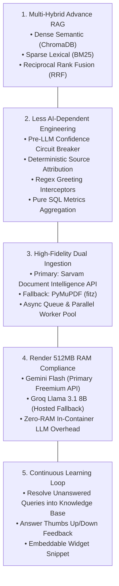
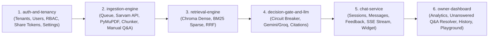
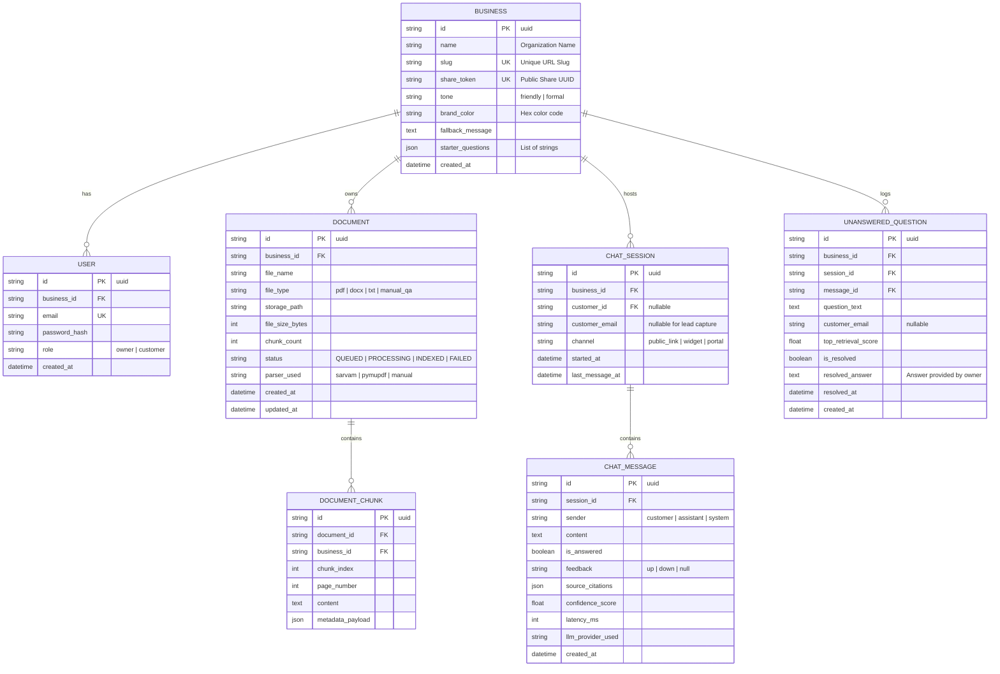
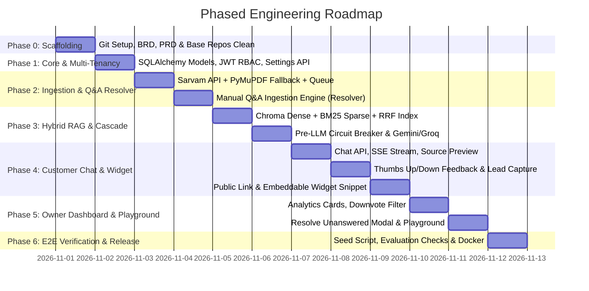

# Product Requirements Document (PRD)
## Project: AI Customer Support Assistant (Multi-Tenant RAG Platform)

---

| Document Metadata | Specification |
| :--- | :--- |
| **Product Name** | AI Customer Support Assistant |
| **Document Version** | 1.1.0 (Enhanced with High-Value Evaluation Features) |
| **Status** | Approved & Ready for Implementation |
| **Target Platforms** | Web Application (Responsive Desktop & Mobile) & Embeddable JS Widget |
| **Backend Stack** | Python 3.11+, FastAPI, SQLAlchemy (Async), ChromaDB, `rank-bm25` |
| **Frontend Stack** | React 18+, TypeScript, Vite, Tailwind CSS, Lucide Icons |
| **Database** | SQLite (Development) $\rightarrow$ PostgreSQL (Render Production) |
| **Base Repositories** | `base_repos/rag-supported-chatbot`, `base_repos/rag-support-sytem`, `base_repos/DocsGPT` |

---

## 1. Product Vision & Architectural Philosophy

The **AI Customer Support Assistant** is a multi-tenant, retrieval-augmented generation (RAG) platform that enables small businesses to turn their static documentation into an accurate, 24/7 AI customer support representative.

### Core Architectural Pillars

---

## 2. High-Value Feature Matrix (Evaluation Boosters)

To maximize project quality and evaluation scoring while keeping execution strictly disciplined, features are tiered into execution waves:

| Feature | Category | Impact on Evaluation | Complexity | Description |
| :--- | :--- | :--- | :--- | :--- |
| **Resolve Unanswered Qs into Knowledge Base** | **Wave 1 (Must Have)** | 🔥 **Highest** (Closes the RAG loop) | Low | Owner types an answer to an unanswered question; system saves it as a Q&A chunk into the vector & BM25 store. Next time asked, the AI answers it accurately! |
| **Answer Feedback (Thumbs Up / Down)** | **Wave 1 (Must Have)** | ⭐ High (Quality assurance signal) | Low | Users can vote on each answer. Votes saved to `chat_messages`. Owner can filter downvoted answers to spot weak documentation. |
| **Source Chunk Preview Modal** | **Wave 1 (Must Have)** | ⭐ High (Proves grounding) | Low | Clicking a citation badge opens a popover showing the exact extracted text chunk and page number from the file. |
| **Shareable Link + Embeddable Widget** | **Wave 1 (Must Have)** | ⭐ High (Production readiness) | Low-Med | Public `/chat/{business-slug}` page PLUS an embeddable `` snippet for third-party sites. |
| **Suggested Starter Questions** | **Wave 1 (Must Have)** | ⭐ High (User experience) | Low | 3–4 clickable question pills on chat open (e.g. "What is your refund policy?", "How long does shipping take?"). |
| **Streaming Answers (SSE)** | **Wave 2 (Medium Effort)** | Medium-High (Modern UX) | Med | Server-Sent Events stream tokens in real-time as generated by the LLM. |
| **Lead Capture / Human Handoff** | **Wave 2 (Medium Effort)** | Medium (Business value) | Low | When the assistant cannot answer, customers can leave their email. Owner sees this lead alongside the unanswered question. |
| **Owner Assistant Customization** | **Wave 2 (Medium Effort)** | Medium (Customizability) | Low | Owner can customize business name, tone (friendly vs formal), fallback message, and primary widget brand color. |
| **Test Playground** | **Wave 2 (Medium Effort)** | High (Demo tool) | Med | Internal chat panel where owner can test queries and see top-retrieved chunk scores and RRF ranks. |
| **Extended Dashboard Analytics** | **Wave 2 (Medium Effort)** | Medium (Operational insights) | Low-Med | Top asked questions, answer rate over time, latency tracking, most-cited documents. |

---

## 3. Capability Map & Module Decomposition

---

## 4. Detailed Functional Specifications

### 4.1 Module 1: `auth-and-tenancy`
- **FR-101**: User registration with roles: `owner` (creates a business workspace) and `customer`.
- **FR-102**: Password hashing using `bcrypt` / `passlib` and stateless JWT session generation.
- **FR-103**: Unique, non-guessable `share_token` (UUID v4) and customizable URL `slug` for every business.
- **FR-104**: Public endpoint `GET /api/public/tenant/:slugOrToken` resolving business name, starter questions, brand color, and tone.
- **FR-105**: Multi-tenant database middleware enforcing `WHERE business_id = current_tenant_id` on every query.
- **FR-106 (Settings)**: Owner can update business name, tone (`formal` | `friendly`), custom fallback message, and widget hex color.

### 4.2 Module 2: `ingestion-engine`
- **FR-201 (File Support)**: Supports `.pdf`, `.docx`, and `.txt` files up to 25MB per file.
- **FR-202 (Dual Extraction Pipeline)**:
  - *Primary*: Sarvam Document Intelligence API (`https://api.sarvam.ai`) using `SARVAM_API_KEY`. Captures tables, multi-column layouts, and multilingual Indic/English text into clean Markdown.
  - *Fallback*: Local `PyMuPDF` (`fitz`) for PDF, `python-docx` for DOCX, and native UTF-8 for TXT.
- **FR-203 (Queue-Based Processing)**:
  - Upload endpoint `POST /api/documents/upload` returns `HTTP 202 Accepted` (`{document_id, status: "QUEUED"}`).
  - Async worker pool (`ThreadPoolExecutor` + `asyncio.Queue`) executes extraction and chunking in the background.
- **FR-204 (Recursive Chunking)**:
  - Chunks text into ~500–800 character windows with 10% overlap.
  - Enriches each chunk with metadata: `{business_id, document_id, document_name, chunk_index, page_number}`.
- **FR-205 (Manual Q&A Resolution Ingestion)** ⭐:
  - Endpoint `POST /api/documents/manual-qa` allows saving an answered question as a persistent knowledge document (`doc_type: "manual_qa"`).
  - Immediately generates embeddings and BM25 tokens, injecting the verified Q&A into the retrieval index!
- **FR-206 (Document CRUD)**:
  - Document listing with status (`QUEUED`, `PROCESSING`, `INDEXED`, `FAILED`).
  - Document deletion instantly purges all associated chunks from ChromaDB and BM25 index.

### 4.3 Module 3: `retrieval-engine`
- **FR-301 (Dense Vector Retrieval)**:
  - Embeds chunks using Google Gemini `text-embedding-004` (or Voyage AI / OpenAI).
  - ChromaDB index filtered strictly by `business_id`. Top-10 semantic neighbors.
- **FR-302 (Sparse Lexical Retrieval)**:
  - `rank-bm25` index per business tenant. Exact keyword, acronym, pricing, and policy terms matching. Top-10 lexical hits.
- **FR-303 (Reciprocal Rank Fusion - RRF)**:
  - Merges Dense and Sparse lists using $RRF(d) = \sum \frac{1}{60 + \text{rank}(d)}$. Deduplicates and ranks top-5 candidate chunks.

### 4.4 Module 4: `decision-gate-and-llm` (Less AI-Dependent)
- **FR-401 (Pre-LLM Confidence Circuit Breaker)**:
  - If top candidate RRF/similarity score $< \text{THRESHOLD}$:
    - **Do NOT call LLM API**.
    - Immediately return business fallback message: *"I don't have this information in my documents. I've logged this question for our team."*
    - Persist query to `unanswered_questions` table (`is_answered = False`).
- **FR-402 (Greeting Interceptor)**:
  - Fast regex for common greetings ("hi", "hello", "thanks") returning instant friendly canned replies.
- **FR-403 (Multi-Tier LLM Cascade)**:
  - *Tier 1 (Primary)*: Google Gemini 1.5/2.0 Flash (free tier: 15 RPM, 1M TPM).
  - *Tier 2 (Fallback)*: Groq Llama 3.1 8B / 3.2 3B Instant (free tier: 30 RPM, 300+ tok/s).
- **FR-404 (Deterministic Citations & Source Preview)**:
  - API attaches chunk metadata (`document_name`, `page_number`, `chunk_id`, `text_excerpt`) directly to the response payload.
  - Customer can click the badge to preview the exact chunk text.

### 4.5 Module 5: `chat-service`
- **FR-501 (Multi-Turn Chat)**: Manages conversation sessions with rolling context (last 4 message pairs).
- **FR-502 (Answer Feedback)** ⭐:
  - Customer can click 👍 or 👎 on any assistant message.
  - Endpoint `POST /api/chat/message/:id/feedback` updates `feedback: 'up' | 'down'`.
- **FR-503 (Lead Capture / Human Handoff)** ⭐:
  - When assistant triggers fallback, UI displays: *"Want us to get back to you? Leave your email."*
  - Endpoint `POST /api/chat/session/:id/lead` saves customer email to `unanswered_questions`.
- **FR-504 (Streaming SSE)**:
  - Endpoint `POST /api/chat/stream` streams tokens word-by-word via Server-Sent Events.
- **FR-505 (Embeddable Widget)** ⭐:
  - Standalone script `widget.js` that any business owner can paste on their website to inject a floating chat widget.

### 4.6 Module 6: `owner-dashboard`
- **FR-601 (Analytics Overview)**:
  - Metrics: Total Chats, Total Questions, Answered vs Unanswered Count, Resolution Rate (%), Average Latency (ms).
  - Extra charts: Top asked questions, Most cited documents, Downvoted answers review.
- **FR-602 (Unanswered Questions & Resolver Loop)** ⭐:
  - Table of all unanswered questions with frequency count and captured customer emails.
  - **"Answer & Add to Knowledge Base" Modal**: Owner types the answer $\rightarrow$ creates `manual_qa` document $\rightarrow$ embeds into vector/BM25 store $\rightarrow$ marks question as resolved!
- **FR-603 (Chat History & Feedback Filter)**:
  - Browse past chat sessions.
  - Toggle filter: "Show only chats with downvoted answers (👎)" for rapid quality debugging.
- **FR-604 (Test Playground)** ⭐:
  - Interactive testing sandbox where the owner queries the assistant and inspects:
    - Retrieved chunks with similarity scores.
    - Sparse vs Dense ranks.
    - LLM generation time and provider used.

---

## 5. Technical Specifications & Database Schema

---

## 6. API Endpoint Contracts

### 6.1 Authentication & Settings (`/api/auth`, `/api/business`)
- `POST /api/auth/register` — Register owner/customer.
- `POST /api/auth/login` — Login and get JWT.
- `GET  /api/business/settings` — Get owner's business settings & share links.
- `PUT  /api/business/settings` — Update tone, brand color, fallback text, starter questions.

### 6.2 Document Ingestion (`/api/documents`)
- `POST /api/documents/upload` — Multipart file upload (`HTTP 202 Accepted`).
- `POST /api/documents/manual-qa` — Create a manual Q&A document chunk from resolved question.
- `GET  /api/documents` — List documents with chunk counts and statuses.
- `DELETE /api/documents/:id` — Delete document and re-index.

### 6.3 Chat, Feedback & Widget (`/api/chat`, `/api/public`)
- `GET  /api/public/business/:slug` — Public metadata for chat widget & standalone link.
- `POST /api/chat/message` — Send query, get answer + source citations.
- `POST /api/chat/stream` — SSE token-by-token streaming.
- `POST /api/chat/message/:id/feedback` — Submit thumbs up (`up`) or thumbs down (`down`).
- `POST /api/chat/session/:id/lead` — Submit customer email for human handoff.

### 6.4 Owner Dashboard & Playground (`/api/dashboard`)
- `GET  /api/dashboard/stats` — Total chats, questions, answered/unanswered counts, avg latency.
- `GET  /api/dashboard/unanswered` — Paginated list of unanswered questions.
- `POST /api/dashboard/unanswered/:id/resolve` — Resolve question and automatically index answer.
- `GET  /api/dashboard/chats` — Chat session explorer with `?filter=downvoted` option.
- `POST /api/dashboard/playground` — Test query with debug metrics (retrieved chunks, scores, RRF ranks).

---

## 7. Phased Implementation Roadmap & Commit Attribution

| Phase | Core Deliverables | Git Author Attribution |
| :--- | :--- | :--- |
| **Phase 0** | Git init, `.gitignore`, [BRD.md](file:///c:/Users/datta.000/Desktop/IDEVIFY/BRD.md), [PRD.md](file:///c:/Users/datta.000/Desktop/IDEVIFY/PRD.md), [README.md](file:///c:/Users/datta.000/Desktop/IDEVIFY/README.md) | `Nishant Datta <dattanishant2@gmail.com>` |
| **Phase 1** | Multi-tenant schema, SQLite dev $\rightarrow$ Postgres prod, JWT RBAC, Business settings & starter questions | `Nishant Datta <dattanishant2@gmail.com>` |
| **Phase 2** | **Sarvam Document Intelligence API** + **PyMuPDF fallback**, async queue worker, chunking, and **Manual Q&A ingestion** | **`Ishwari Bhoyar <ishwaribhoyar2@gmail.com>`** |
| **Phase 3** | **Multi-Hybrid RAG** (ChromaDB + BM25 + RRF), **Pre-LLM Confidence Circuit Breaker**, **Gemini Flash $\rightarrow$ Groq Llama cascade** | **`Ishwari Bhoyar <ishwaribhoyar2@gmail.com>`** |
| **Phase 4** | Customer chat API, SSE streaming, **Answer Feedback (👍/👎)**, **Lead Capture form**, **Source chunk preview**, **Embeddable Widget** | `Ishwari Bhoyar <ishwaribhoyar2@gmail.com>` & `Nishant Datta` |
| **Phase 5** | Analytics Dashboard, **Resolve Unanswered Questions into Knowledge Base**, Downvote filter, **Test Playground** | `Nishant Datta <dattanishant2@gmail.com>` |
| **Phase 6** | Sample business seeder (`seed.py`), 4-point Idevify evaluation verification suite, Render deployment configuration | Joint Final Release |

---

## 8. Multi-Device Authentication & Analytics Telemetry Specs

### 8.1 Cross-Device Identity Synchronization
- Seamless workspace recovery via `/api/auth/active-owner` and `/api/auth/session/validate`.
- Case-insensitive email normalization across registration and sign-in handlers.
- Auto-redirect and session persistence preventing data fragmentation across mobile and desktop devices.

### 8.2 Power BI / Excel Live Connector Architecture
- Direct streaming `/api/dashboard/export/powerbi?format=csv` with UTF-8 BOM (`\ufeff`) compatibility.
- Transparent query token authentication (`?token=...`) supporting automated enterprise scheduled refreshes.
- Response headers `X-Dataset-Rows` and `X-Dataset-Schema-Version` for ETL ingestion pipelines.
