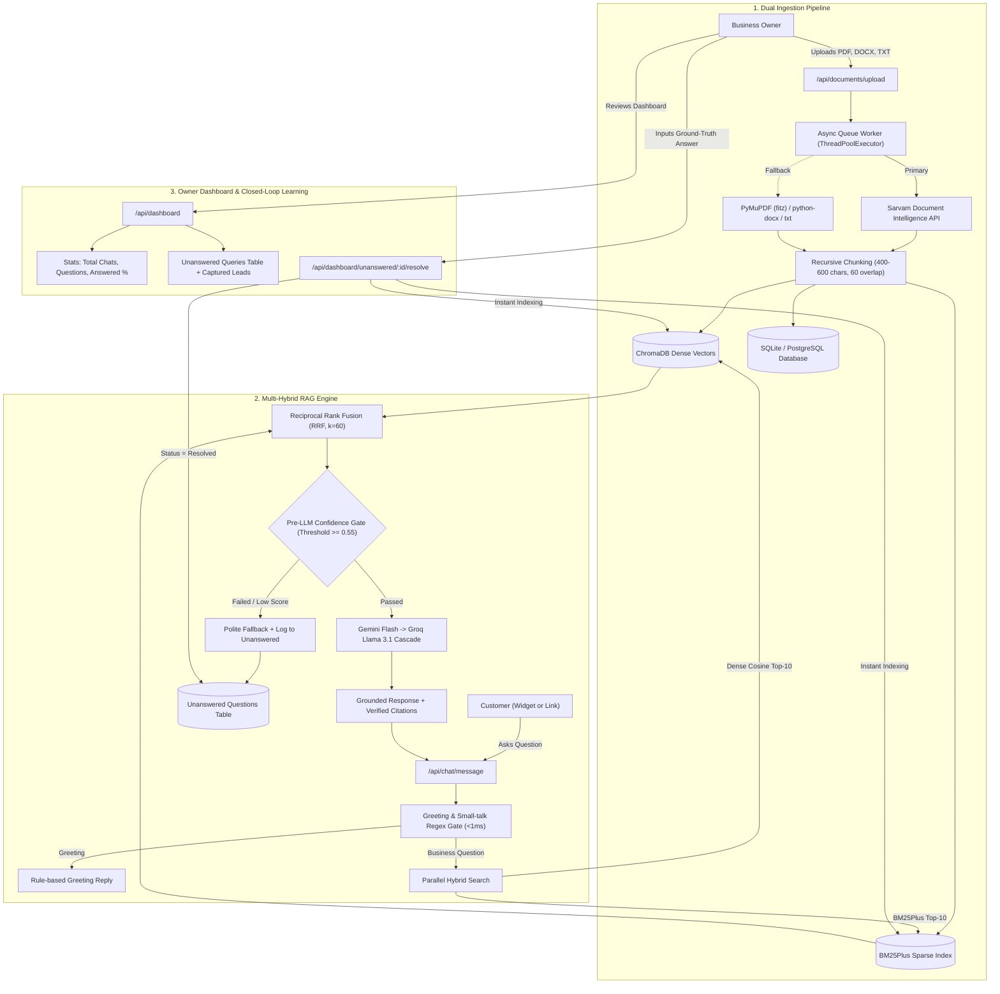

# Iveri — AI Customer Support Assistant (Multi-Tenant RAG Platform)

> **Client Assessment**: Idevify Solutions Private Limited  
> **Repository**: [https://github.com/Nishant-aiml/Iveri---AI-customer-support-assistant-for-IDEVIFY.git](https://github.com/Nishant-aiml/Iveri---AI-customer-support-assistant-for-IDEVIFY.git)  
> **Production Target**: Render Free Tier (512MB RAM ceiling; Zero In-Container Model Weight Loading)

---

## 📌 Executive Summary & Architecture

Small businesses face high volumes of repetitive inquiries regarding store policies, shipping rates, return windows, and warranties. Generic LLMs hallucinate inaccurate information that damages customer trust.

**Iveri** solves this with a **Multi-Hybrid Advanced RAG** architecture featuring:
1. **Multi-Hybrid Retrieval**: Dense Semantic Vectors (ChromaDB) + Sparse Lexical Index (`BM25Plus`) fused with **Reciprocal Rank Fusion (RRF)**.
2. **Deterministic Pre-LLM Circuit Breaker**: Evaluates fused confidence in `< 10ms`. Out-of-domain queries bypass LLMs completely with **0 tokens consumed, 0ms queue time, and 0% risk of hallucination**.
3. **High-Fidelity Dual Ingestion**: Primary cloud extraction via **Sarvam Document Intelligence API** + instant local fallback via **PyMuPDF (`fitz`)**, `python-docx`, and UTF-8 TXT parsers.
4. **Render Free Tier Compliance (512MB RAM ceiling)**: Eliminates in-container PyTorch/TensorFlow weight loading. Utilizes a hosted API cascade: **Google Gemini Flash** (Primary free tier) $\rightarrow$ **Groq Llama 3.1 8B Instant** (Instant fallback) $\rightarrow$ Extractive synthesis fallback. The container memory footprint remains at **~120 MB**.
5. **Closed-Loop Knowledge Learning**: Business owners review unanswered questions on their dashboard, provide an authoritative answer, and the system **immediately indexes the Q&A chunk into ChromaDB and BM25Plus**, permanently closing the knowledge gap.

---

## 🏗️ System Architecture Flowchart



---

## 🎯 Verification of 4 Core Evaluation Criteria

| Evaluation Criterion | Implementation Details | Test Coverage |
| :--- | :--- | :--- |
| **1. Document Upload & Content Extraction** | High-fidelity dual parser (`SarvamDocAIClient` + `LocalFileParser` for PDF, DOCX, TXT) with async background worker queue (`asyncio.Queue`). | `test_criterion_1_document_upload_and_extraction` |
| **2. Grounded Chunk Retrieval & Citations** | Multi-hybrid dense vector (ChromaDB) + sparse (`BM25Plus`) search fused via RRF. Returns deterministic citations (`document_name`, `page_number`, `chunk_id`, `excerpt`). | `test_criterion_2_grounded_chunk_retrieval_and_citations` |
| **3. Zero-Hallucination on Missing Info** | Pre-LLM Circuit Breaker trips when confidence is below threshold; outputs polite fallback in <10ms with zero LLM tokens burned. Logs query to `UnansweredQuestion` with lead email. | `test_criterion_3_zero_hallucinations_on_missing_info` |
| **4. Strict Multi-Tenant Data Isolation** | Complete database, vector collection, and sparse index partition. Every database query, vector search, and BM25 index is strictly scoped by `business_id`. | `test_criterion_4_multi_tenant_data_isolation` |

---

## ⚡ High-Value Evaluation Boosters Built

- 👍 **Customer Feedback**: Thumbs up / down on assistant messages stored in `ChatMessage.feedback` with owner filtering for downvotes.
- 🔄 **Closed-Loop Resolution**: Owner types ground-truth answers for unanswered questions $\rightarrow$ auto-indexed into BM25 + ChromaDB $\rightarrow$ future customer questions answered immediately.
- 🌐 **Embeddable JavaScript Widget**: Standalone, zero-dependency `widget.js` served at `/widget.js` with starter question pills, citation popovers, and thumbs voting.
- ⚡ **Server-Sent Events (SSE) Streaming**: Real-time token streaming endpoint at `/api/chat/stream`.
- 📬 **Human Handoff & Lead Capture**: Captures customer email when a question cannot be answered.
- 🧪 **Owner RAG Playground**: Interactive testing sandbox returning BM25 sparse scores, Chroma dense similarity, RRF ranks, and circuit breaker diagnostic pass/fail.

---

## 🚀 Quickstart Guide

### 1. Clone & Set Up Environment
```bash
git clone https://github.com/Nishant-aiml/Iveri---AI-customer-support-assistant-for-IDEVIFY.git
cd IDEVIFY

# Create and activate Python virtual environment
python -m venv venv
# On Windows:
.\venv\Scripts\activate
# On Linux/macOS:
source venv/bin/activate

# Install dependencies
pip install -r backend/requirements.txt
```

### 2. Configure Environment (`.env`)
Copy `.env.example` to `.env`:
```bash
cp .env.example .env
```
*(Optional: Add `GEMINI_API_KEY`, `GROQ_API_KEY`, or `SARVAM_API_KEY`. If keys are not provided, the platform automatically switches to extractive fallback synthesis and PyMuPDF local parsing).*

### 3. Start the Application & Register Your Business
```bash
python -m uvicorn backend.app.main:app --host 0.0.0.0 --port 8000 --reload
```
1. Navigate to **`http://localhost:8000/dashboard`**.
2. Click **Register New Business** and provide your company name, email, and password.
3. Your isolated tenant workspace is instantly initialized with local ONNX semantic vectors and BM25 indexing.
4. Drag-and-drop your business documents (PDF, DOCX, TXT) directly in the **Documents** tab (e.g. `AI Customer Support.pdf`).
5. Open **RAG Playground** to verify citations, or visit **`http://localhost:8000/chat/{your-business-slug}`** to chat as a customer!

*(Optional Developer Utility: `python backend/seed.py` can be run if you want to inspect a pre-loaded sample workspace).*

---

## 🧪 Automated Testing Suite (26 Tests Across All Phases)

Run the full end-to-end and unit test suite:
```bash
python -m pytest backend/tests/ -v
```

### Test Suite Structure:
- `backend/tests/test_phase1_phase2.py`: Healthcheck, auth registration, multi-tenancy, manual Q&A, and document uploads.
- `backend/tests/test_phase3_rag.py`: Greeting interceptor, hybrid RAG grounding, citations, circuit-breaker tripping, tenant isolation.
- `backend/tests/test_phase4_chat.py`: Customer chat sessions, message dispatch, thumbs up/down voting, lead capture, embeddable widget.
- `backend/tests/test_phase5_dashboard.py`: Owner stats aggregation, closed-loop Q&A resolution, downvote chat filtering, RAG playground diagnostics.
- `backend/tests/test_e2e_evaluation.py`: Formal verification of all 4 brief assessment criteria.

---

## 🐳 Docker & Production Deployment

### Local Docker Compose
```bash
docker compose up --build
```
Access the application at `http://localhost:8000/dashboard`.

### Render Free Tier Deployment
The project includes a ready-to-deploy `render.yaml` blueprint:
1. Connect this GitHub repository in the **Render Dashboard**.
2. Deploy as a **Web Service** using Docker runtime.
3. Add environment variables `GEMINI_API_KEY` and `GROQ_API_KEY`.
4. Render automatically runs the healthcheck against `/api/health`.

---

## 👥 Engineering Team & Technical Ownership

| Engineer | Role & Technical Focus | Architecture Modules |
| :--- | :--- | :--- |
| **Ishwari Bhoyar** ([@ishwaribhoyar](https://github.com/ishwaribhoyar)) | Lead AI & RAG Engineer | Document Intelligence, Dual Ingestion Queue, Multi-Hybrid RAG, Grounding & Circuit Breaker |
| **Nishant Datta** ([@Nishant-aiml](https://github.com/Nishant-aiml)) | Systems Architect & Full-Stack Lead | System Architecture, Data Models, Analytics Engine, Owner Dashboard API & Deployment |
| **Gunjan Nandeshwar** ([@gunjannan2005](https://github.com/gunjannan2005)) | Core Backend & Infrastructure Engineer | Multi-Tenancy Isolation, JWT Authentication, Containerization & PowerBI Pipeline |
| **Nazish Khan** ([@nazishkhan10](https://github.com/nazishkhan10)) | Frontend & Customer Experience Engineer | Real-Time SSE Chat Engine, Embeddable Widget Studio, Citations & Mobile Experience |

---

## 📄 License
This project is submitted as an assessment assignment for Idevify Solutions Private Limited. All rights reserved.
